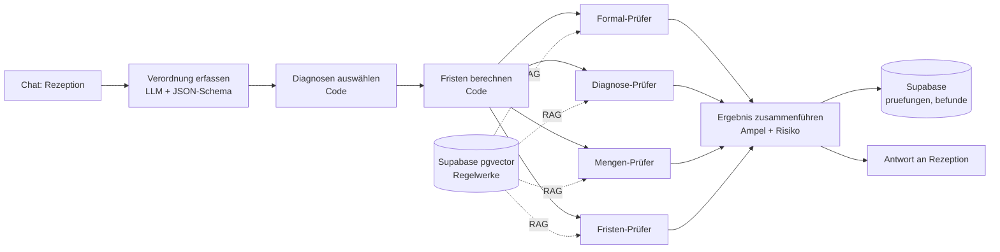

# Verordnungs-Check

KI-gestützte Prüfung ärztlicher Heilmittelverordnungen für eine Physiotherapie-Praxis – bevor behandelt wird, nicht erst bei der Abrechnung.

Capstone-Projekt im Programm *AI Automations & Agents Engineer* (MSIT) und Grundlage der Abschlussprüfung *KI-Tool-Experte/Expertin (IHK)*.

> **Hinweis:** Das Praxisbeispiel ist anonymisiert. Der Prototyp arbeitet ausschließlich mit **synthetischen Verordnungen**. Es werden keine echten Patientendaten verarbeitet.

## Problem

Formfehler auf Heilmittelverordnungen fallen oft erst bei der Abrechnung auf. Dann setzt die Krankenkasse ab: Die Leistung ist erbracht, das Geld fehlt. Die Rezeption hat im Alltag keine Zeit, jede Verordnung gegen Heilmittel-Richtlinie, Heilmittelkatalog und Diagnoseliste zu prüfen.

## Lösung

Die Rezeption gibt die Angaben einer Verordnung in einen Chat ein. Vier spezialisierte Prüf-Agenten prüfen parallel ihr jeweiliges Mandat und belegen ihre Befunde mit Fundstellen aus den Regelwerken (RAG). Das Ergebnis ist eine Ampel mit konkreten Korrekturhinweisen und einem geschätzten Absetzungsrisiko. Jede Prüfung wird protokolliert.

| Prüfer | Mandat | Wissensquelle |
|---|---|---|
| Formal-Prüfer | Pflichtangaben vollständig und formal korrekt | Heilmittel-Richtlinie |
| Diagnose-Prüfer | ICD-10-Code passt zur Diagnosegruppe, Leitsymptomatik, besonderer Verordnungsbedarf | Heilmittelkatalog, KBV-Diagnoseliste |
| Mengen-Prüfer | Höchstmenge je Verordnung, Heilmittel-Kombination, Frequenz | Heilmittelkatalog, Heilmittel-Richtlinie |
| Fristen-Prüfer | Behandlungsbeginn, Unterbrechung | Heilmittel-Richtlinie; Tage rechnet der Code |

Die Rezeption entscheidet. Das System gibt Empfehlungen, es weist nichts automatisch ab.

## Ausgabe: Vorschau der ausgefüllten Verordnung

Ergebnis der Prüfung ist neben der Ampel eine **Vorschau der ausgefüllten Heilmittelverordnung (Muster 13)**: Der erfasste Fall wird auf den Vordruck gezeichnet, damit die Rezeption sieht, was tatsächlich auf dem Formular steht – und was dort nicht hingehört.

Die Vorschau ist eine statische Seite ohne Build: [`preview/muster13.html`](preview/muster13.html) im Browser öffnen, sie lädt die Ausgabe des Workflows (Beispielfall enthalten, echte Ausgaben über „Workflow-Ausgabe laden"). Sie rechnet und erfindet nichts – fehlende Werte bleiben leer.

Zwei Dinge sind dabei fachlich entscheidend ([`docs/vordruck-muster13.md`](docs/vordruck-muster13.md)):

- Auf den Vordruck passen **zwei ICD-10-GM-Codes**. Erkannt werden im Freitext oft mehr, deshalb wählt der Workflow nach einer festen Regel aus (führende Diagnose + zweite Diagnose, übrige Codes mit Begründung als „nicht übernommen" sichtbar).
- Der Vordruck kennt **keinen Behandlungsbeginn, keine Erst-/Folgeverordnung und kein Ankreuzfeld „besonderer Verordnungsbedarf"**. Die Frist läuft ab dem Ausstellungsdatum (§ 15 Abs. 1 HeilM-RL), der Verordnungsfall ersetzt die Verordnungsart (§ 7 Abs. 1), und besonderer Bedarf wird über die ICD-Codes der Diagnoseliste geltend gemacht.

## Architektur



Details: [docs/architektur.md](docs/architektur.md)

## Technik

- **n8n** – Orchestrierung, Chat-Oberfläche, vier AI-Agenten
- **OpenRouter** – `google/gemini-3.1-flash-lite` für die Agenten, `google/gemini-embedding-001` (1536 Dimensionen) für die Vektorsuche
- **Supabase** – PostgreSQL mit pgvector für die Wissensbasis und das Prüfprotokoll (EU-Region Frankfurt)

### n8n lokal starten (ohne Cloud-Zugang)

n8n läuft als npm-Paket mit, eine eigene Installation ist nicht nötig:

```bash
npm install                                   # installiert n8n aus den devDependencies
cp .env.example .env                          # Werte eintragen, u. a. N8N_ENCRYPTION_KEY erzeugen
npm run n8n                                   # Oberfläche auf http://127.0.0.1:5678
```

Beim ersten Start in der Oberfläche anmelden, dann die Zugangsdaten anlegen
(Credentials → Add credential):

| Credential | Typ | Inhalt |
|---|---|---|
| OpenRouter | OpenRouter | API-Key von openrouter.ai |
| OpenRouter (OpenAI-kompatibel) | OpenAI | API-Key wie oben, Base URL `https://openrouter.ai/api/v1`, zusätzlich Option *Dimensions* = `1536` |
| Supabase Verordnungs_check | Supabase | Host und Secret Key des Projekts |

Zwei Credentials sind nötig, weil n8n keinen OpenRouter-Embedding-Knoten kennt:
Die Vektorsuche läuft über den OpenAI-Knoten mit umgebogener Base URL.

Workflows und Wissensbasis:

```bash
npm run n8n:vorbereiten                       # Import-Datei für die lokale Instanz erzeugen (webhookId + Workflow-ID)
npx n8n import:workflow --input=.n8n/tmp/vier-pruefer-lokal.json
npx n8n update:workflow --id=<workflow-id> --active=true   # nach jedem Import aktivieren
npm run n8n:import:credentials                # optional: Credentials aus .n8n/credentials/ importieren
npm run n8n:execute -- --id <workflow-id>     # Workflow ohne Oberfläche ausführen (z. B. Wissensbasis laden)
npm run vorschau:lauf                         # letzten Lauf in die Vorschau holen (preview/)
```

Der Ordner `.n8n/` (Datenbank, Credentials, Schlüssel) ist per `.gitignore`
ausgenommen. Nach einem Wechsel des Embedding-Modells muss die Wissensbasis
neu geladen werden, sonst passen die Vektoren nicht mehr zusammen.

## Wissensquellen (frei zugänglich)

- Heilmittel-Richtlinie des G-BA, Fassung in Kraft seit 05.08.2025
- Heilmittelkatalog des G-BA (Zweiter Teil der Heilmittel-Richtlinie)
- Heilmittel-Diagnoseliste der KBV, Stand 01.01.2026
- ICD-10-GM 2026 (BfArM) – bewusst nicht vollständig im Repository, siehe Nutzungsbedingungen des BfArM

## Repository

| Ordner | Inhalt |
|---|---|
| `n8n/` | Exportierte Workflows (.json) |
| `scripts/` | Hilfsskripte für die lokale n8n-Instanz (Import vorbereiten) |
| `preview/` | Vorschau der ausgefüllten Verordnung (Muster 13), Beispieldaten, kein Build |
| `supabase/migrations/` | Datenbankschema |
| `supabase/seed/` | Synthetische Testverordnungen (7 Testfälle + 3 Kontrollfälle) |
| `tests/` | Automatische Tests für den Code-Anteil (`node tests/fakten.test.mjs`, `node tests/diagnosen.test.mjs`) und für die Vorschau (`node tests/vorschau.test.mjs`), zusammen mit `npm test` |
| `docs/` | Design-Briefing (Scope, Erfolgskriterien, Implementierungsweg, Architektur, Build-Plan), Dateneingang, Evaluation, Governance, Vordruck Muster 13 |

## Team

| Name | Rolle |
|---|---|
| Thomas Kullmann | Analyse & Business Case, Projektleitung |
| Valentin | Tools & Architektur |
| Derk | Build & Demo |
| Süle | Evaluation & Governance |

## Status

Prototyp läuft (Stand 13.10.2026):

- Wissensbasis geladen: HeilM-RL, Heilmittelkatalog, KBV-Diagnoseliste (rund 380 Abschnitte in Supabase)
- Vier Prüfer, Ampel und Protokoll funktionieren durchgängig, rund 24 Sekunden und 3–4 Cent je Prüfung
- Evaluation: 10 von 10 Ampeln korrekt, 0 kritische Fehlalarme (Baseline: 12), Details in [`docs/evaluation.md`](docs/evaluation.md)

Design-Briefing (Sprint 1): [Scope](docs/scope.md) · [Erfolgskriterien](docs/erfolgskriterien.md) · [Implementierungsweg](docs/implementierung.md) · [Architektur](docs/architektur.md) · [Build-Plan](docs/build-plan.md)

Geplant für Sprint 2: Verordnungsfall-Prüfung (Folgeverordnungen, orientierende Behandlungsmenge), siehe [`docs/dateneingang.md`](docs/dateneingang.md). Foto-Upload nur bei Puffer.

Offen: Ist-Interview mit der Praxis, Business Case, EU-AI-Act-Einordnung, Präsentation.

Ergänzung 14.10.2026: Die Vorschau der ausgefüllten Verordnung liegt in
[`preview/`](preview/README.md), die Feldzuordnung (Workflow → Vordruck) und die
Auswahlregel für die zwei Diagnosen in [`docs/vordruck-muster13.md`](docs/vordruck-muster13.md).

Ergänzung 15.10.2026: Das Schema `Verordnung` liefert jetzt auch Personalien,
Kennzeichen und Stammdaten, der Code-Node **Diagnosen auswählen** belegt die zwei
ICD-10-Zeilen nach dieser Regel. Mit `npm run vorschau:lauf` wird der letzte
lokale Lauf direkt in die Vorschau geholt (siehe [`preview/`](preview/README.md)).
