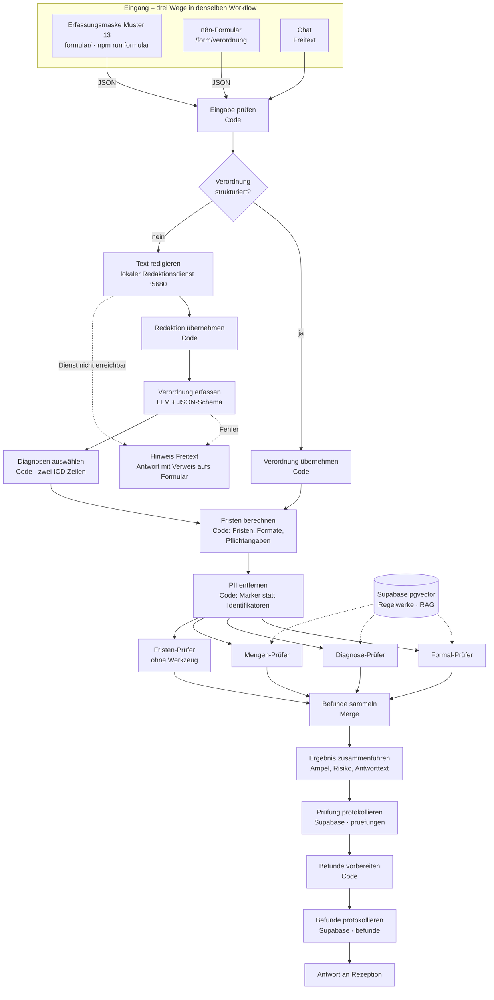

# Verordnungs-Check

KI-gestützte Prüfung ärztlicher Heilmittelverordnungen für eine Physiotherapie-Praxis – bevor behandelt wird, nicht erst bei der Abrechnung.

Capstone-Projekt im Programm *AI Automations & Agents Engineer* (MSIT) und Grundlage der Abschlussprüfung *KI-Tool-Experte/Expertin (IHK)*.

> **Hinweis:** Das Praxisbeispiel ist anonymisiert. Der Prototyp arbeitet ausschließlich mit **synthetischen Verordnungen**. Es werden keine echten Patientendaten verarbeitet.

## Problem

Formfehler auf Heilmittelverordnungen fallen oft erst bei der Abrechnung auf. Dann setzt die Krankenkasse ab: Die Leistung ist erbracht, das Geld fehlt. Die Rezeption hat im Alltag keine Zeit, jede Verordnung gegen Heilmittel-Richtlinie, Heilmittelkatalog und Diagnoseliste zu prüfen.

## Lösung

Die Rezeption gibt die Angaben einer Verordnung in einen Chat ein. Vier spezialisierte Prüf-Agenten prüfen parallel ihr jeweiliges Mandat und belegen ihre Befunde mit Fundstellen aus den Regelwerken (RAG). Das Ergebnis ist eine Ampel mit konkreten Korrekturhinweisen und einem geschätzten Absetzungsrisiko. Jede Prüfung wird protokolliert.

| Prüfer | Mandat | Wissensquelle |
|---|---|---|
| Formal-Prüfer | Pflichtangaben vollständig und formal korrekt | Heilmittel-Richtlinie |
| Diagnose-Prüfer | ICD-10-Code passt zur Diagnosegruppe, Leitsymptomatik, besonderer Verordnungsbedarf | Heilmittelkatalog, KBV-Diagnoseliste |
| Mengen-Prüfer | Höchstmenge je Verordnung, Heilmittel-Kombination, Frequenz | Heilmittelkatalog, Heilmittel-Richtlinie |
| Fristen-Prüfer | Behandlungsbeginn, Unterbrechung | Heilmittel-Richtlinie; Tage rechnet der Code |

Die Rezeption entscheidet. Das System gibt Empfehlungen, es weist nichts automatisch ab.

## Eingabe: ausgefüllte Verordnung statt Freitext

Drei Wege führen in dieselbe Prüfung:

1. **Erfassungsmaske** (A5-Vordruck am Bildschirm, für die Demo): Der Vordruck
   Muster 13 wird ausgefüllt – dieselbe Geometrie wie das Papier, inklusive
   Ankreuzfeldern für Zuzahlung, Bereich, Leitsymptomatik und Hausbesuch. Ein Klick
   auf **Verordnung prüfen** schickt die Angaben als strukturiertes JSON an den
   Workflow; Ampel, Befunde und Fundstellen erscheinen daneben.
   Start: `npm run formular` → [`formular/muster13.html`](formular/README.md).
2. **n8n-Formular** (Standardweg, alles in n8n): `http://localhost:5678/form/verordnung`
   zeigt ein von n8n gerendertes Formular mit denselben Feldern. Nach dem Absenden
   prüft der Workflow und die Abschlussseite zeigt Ampel, Tabelle und Prüfpunkte.
   Workflow: [`n8n/formular.json`](n8n/formular.json) (Form Trigger → Mapping →
   Aufruf des Prüf-Workflows → Ergebnisseite).
3. **Freitext im Chat**: Liegt die Verordnung nur als Text vor, erfasst ein
   LLM-Agent sie im festen Schema. Fehlende Angaben werden `null`, nichts wird
   geraten.

Zum Ausprobieren ohne Tippen: Unter `npm run formular` → `http://127.0.0.1:4321/vorlagen`
liegen die 23 Testfälle aus dem Seed als Karten – jeder Fall deckt mindestens eines der
18 Prüfkriterien ab ([`docs/pruefkriterien.md`](docs/pruefkriterien.md)). Ein Klick prüft
den Fall und stellt das Ergebnis neben die dort dokumentierte Erwartung;
`npm run vorlagen:pruefen` macht dasselbe per CLI, prüft die erwarteten Befunde und gibt
eine Abdeckungstabelle der 18 Kriterien aus.

Der Workflow erkennt strukturiertes JSON selbst (`Eingabe prüfen` → `Verordnung
strukturiert?`) und überspringt dann den Extraktor; die vier Prüfer laufen in beiden
Fällen identisch.

## Datenschutz: keine Personendaten an die Agenten

Vor den Prüf-Agenten steht der Code-Node **PII entfernen**. Er ersetzt Namen,
Geburtsdatum, Versichertennummer, LANR/BSNR sowie Arzt- und Praxisangaben durch Marker
wie `[Name]` und entfernt Freitextfelder; das Original bleibt für Protokoll und Antwort
erhalten. Im Freitext-Weg redigiert zusätzlich ein **lokaler Redaktionsdienst**
([`redaktion/`](redaktion/README.md), Port 5680) mit einem HuggingFace-Modell plus Regeln
– Namen werden damit auch ohne Rollenwort erkannt. Ist der Dienst nicht erreichbar, wird
der Freitext-Weg abgeschaltet statt unredigiert an ein Modell zu gehen. Was entfernt wird,
was bleibt, wo noch Rohdaten liegen (n8n-Ausführungen, Supabase-Protokoll) und welche
Grenzen der Freitext-Weg hat, steht in [`docs/pii-redaktion.md`](docs/pii-redaktion.md) –
geprüft mit `tests/pii.test.mjs`, `npm run test:redaktion` und `npm run redaktion:pruefen`.

Zwei Dinge sind dabei fachlich entscheidend
([`docs/vordruck-muster13.md`](docs/vordruck-muster13.md)):

- Auf den Vordruck passen **zwei ICD-10-GM-Codes**. Im Formular wählt sie die
  Rezeption; im Freitext wählt sie der Code-Node `Diagnosen auswählen` nach einer
  festen Regel, die übrigen Codes erscheinen mit Begründung als „nicht übernommen".
- Der Vordruck kennt **keinen Behandlungsbeginn, keine Erst-/Folgeverordnung und kein Ankreuzfeld „besonderer Verordnungsbedarf"**. Die Frist läuft ab dem Ausstellungsdatum (§ 15 Abs. 1 HeilM-RL), der Verordnungsfall ersetzt die Verordnungsart (§ 7 Abs. 1), und besonderer Bedarf wird über die ICD-Codes der Diagnoseliste geltend gemacht.

## Architektur



Beide strukturierten Wege überspringen Redaktion, Extraktor und Diagnoseauswahl; alle drei
Wege laufen danach durch dieselbe faktenbasierte Redaktion, dieselben Prüfer und dieselbe
Protokollierung. Der Redaktionsdienst entscheidet nichts – er entfernt nur Identifikatoren
(fail-closed: ist er nicht erreichbar, wird kein Modell aufgerufen). Der Fristen-Prüfer
arbeitet ohne Werkzeug, sein Mandat ist durch die berechneten Fakten bestimmt.

Details: [docs/architektur.md](docs/architektur.md)

## Technik

- **n8n** – Orchestrierung, Chat-Oberfläche, vier AI-Agenten
- **OpenRouter** – `google/gemini-3.1-flash-lite` für die Agenten, `google/gemini-embedding-001` (1536 Dimensionen) für die Vektorsuche
- **Supabase** – PostgreSQL mit pgvector für die Wissensbasis und das Prüfprotokoll (EU-Region Frankfurt)
- **Lokaler Redaktionsdienst** – Python/FastAPI mit `Davlan/bert-base-multilingual-cased-ner-hrl` (HuggingFace, im Image eingebacken, läuft offline) für die PII-Redaktion im Freitext-Weg

### n8n lokal starten (ohne Cloud-Zugang)

n8n läuft als npm-Paket mit, eine eigene Installation ist nicht nötig:

```bash
npm install                                   # installiert n8n aus den devDependencies
cp .env.example .env                          # Werte eintragen, u. a. N8N_ENCRYPTION_KEY erzeugen
npm run n8n                                   # Oberfläche auf http://127.0.0.1:5678
```

Beim ersten Start in der Oberfläche anmelden, dann die Zugangsdaten anlegen
(Credentials → Add credential):

| Credential | Typ | Inhalt |
|---|---|---|
| OpenRouter | OpenRouter | API-Key von openrouter.ai |
| OpenRouter (OpenAI-kompatibel) | OpenAI | API-Key wie oben, Base URL `https://openrouter.ai/api/v1`, zusätzlich Option *Dimensions* = `1536` |
| Supabase Verordnungs_check | Supabase | Host und Secret Key des Projekts |

Zwei Credentials sind nötig, weil n8n keinen OpenRouter-Embedding-Knoten kennt:
Die Vektorsuche läuft über den OpenAI-Knoten mit umgebogener Base URL.

Workflows und Wissensbasis:

```bash
npm run n8n:vorbereiten                       # Import-Datei für die lokale Instanz erzeugen (webhookId + Workflow-ID)
npx n8n import:workflow --input=.n8n/tmp/vier-pruefer-lokal.json
npx n8n update:workflow --id=<workflow-id> --active=true   # nach jedem Import aktivieren
# n8n ≥ 2.20: n8n publish:workflow --id=<workflow-id>
npm run n8n:import:credentials                # optional: Credentials aus .n8n/credentials/ importieren
npm run n8n:execute -- --id <workflow-id>     # Workflow ohne Oberfläche ausführen (z. B. Wissensbasis laden)
npm run formular                            # Erfassungsmaske + Vorlagen auf http://127.0.0.1:4321
npm run vorlagen:pruefen                    # alle Testfälle gegen den laufenden Workflow prüfen
npm run redaktion:bauen                     # lokaler Redaktionsdienst (PII) bauen
npm run redaktion:starten                   # Dienst auf http://127.0.0.1:5680
```

### Welcher Port gehört wem

| Port | Dienst | Start | Läuft |
|---|---|---|---|
| **5678** | n8n (Editor, Chat, n8n-Formular) | `npm run n8n` **oder** `docker start <container>` | bis Prozess/Container endet |
| **5680** | Redaktionsdienst (PII, nur Freitext-Weg) | `npm run redaktion:starten` (Docker) oder `npm run redaktion:lokal` (Python) | Container mit `--restart unless-stopped`, sonst bis zum Beenden |
| **4321** | Dateiserver für `formular/` – Erfassungsmaske **und** Vorlagen-Seite | `npm run formular` | **nur solange der Befehl läuft** (kein Docker, kein Autostart) |

Der Server auf 4321 ist bewusst ein einfacher Node-Prozess (`scripts/formular-server.mjs`),
der `formular/` ausliefert: `http://127.0.0.1:4321/muster13.html` und
`http://127.0.0.1:4321/vorlagen`. Er ist nötig, weil die Seiten die Verordnung per `fetch`
an n8n schicken – aus `file://` blockieren das viele Browser. Anderer Port bei Bedarf:
`FORMULAR_PORT=4400 npm run formular`. Beenden mit `Strg+C` im Terminal.

Port 5678 gehört n8n; der Redaktionsdienst für den Freitext-Weg läuft deshalb auf 5680
(Details: [`redaktion/README.md`](redaktion/README.md)).

Der Ordner `.n8n/` (Datenbank, Credentials, Schlüssel) ist per `.gitignore`
ausgenommen. Nach einem Wechsel des Embedding-Modells muss die Wissensbasis
neu geladen werden, sonst passen die Vektoren nicht mehr zusammen.

### n8n in einer bestehenden Instanz (z. B. Docker)

Für eine schon laufende Instanz erzeugt `npm run n8n:vorbereiten` zusätzlich ein
Paar aus Workflow und Credentials unter `.n8n/tmp/import-fremdinstanz/`. Das ist
nötig, weil der CLI-Import bei älteren n8n-Versionen (getestet mit 2.20.8) IDs in
der Datei erwartet und Credentials nur über die ID auflöst – der Import über die
Oberfläche erledigt beides selbst:

```bash
npm run n8n:vorbereiten
docker cp .n8n/tmp/import-fremdinstanz/credentials.json  <container>:/tmp/
docker cp .n8n/tmp/import-fremdinstanz/vier-pruefer.json <container>:/tmp/
docker exec <container> n8n import:credentials --input=/tmp/credentials.json
docker exec <container> n8n import:workflow    --input=/tmp/vier-pruefer.json
docker exec <container> n8n update:workflow --id=<workflow-id> --active=true
# ab n8n 2.20 (z. B. 2.20.8): docker exec <container> n8n publish:workflow --id=<workflow-id>
docker restart <container>
```

Danach antwortet der Chat unter `http://localhost:5678/webhook/verordnungs-check/chat`
(POST mit `{"action":"sendMessage","sessionId":"…","chatInput":"…"}`) oder über die
Chat-Ansicht im Editor. Die Erfassungsmaske schickt ihre Verordnung an dieselbe
Adresse – `npm run formular` öffnet sie auf Port 4321. Die Wissensbasis liegt in
Supabase und muss nur geladen werden, wenn die Instanz auf ein anderes Projekt zeigt.

## Wissensquellen (frei zugänglich)

- Heilmittel-Richtlinie des G-BA, Fassung in Kraft seit 05.08.2025
- Heilmittelkatalog des G-BA (Zweiter Teil der Heilmittel-Richtlinie)
- Heilmittel-Diagnoseliste der KBV, Stand 01.01.2026
- ICD-10-GM 2026 (BfArM) – bewusst nicht vollständig im Repository, siehe Nutzungsbedingungen des BfArM

## Repository

| Ordner | Inhalt |
|---|---|
| `n8n/` | Exportierte Workflows (.json) |
| `scripts/` | Hilfsskripte für die lokale n8n-Instanz (Import vorbereiten) |
| `formular/` | Erfassungsmaske Muster 13 (Eingabe), Vorlagen-Seite mit den Testfällen, Beispieldaten, kein Build |
| `redaktion/` | Lokaler Redaktionsdienst (HuggingFace-NER + Regeln) für den Freitext-Weg, Port 5680 |
| `n8n/formular.json` | n8n-Formular (Form Trigger) mit denselben Feldern, Abschlussseite mit Ergebnis |
| `supabase/migrations/` | Datenbankschema |
| `supabase/seed/` | Synthetische Testverordnungen (7 Testfälle + 3 Kontrollfälle) |
| `tests/` | Automatische Tests für den Code-Anteil (`node tests/fakten.test.mjs`, `node tests/diagnosen.test.mjs`), die PII-Redaktion (`node tests/pii.test.mjs`) und die Erfassungsmaske (`node tests/formular.test.mjs`), zusammen mit `npm test`; die Regeln des Redaktionsdienstes prüft `npm run test:redaktion` |
| `docs/` | Design-Briefing (Scope, Erfolgskriterien, Implementierungsweg, Architektur, Build-Plan), Dateneingang, Evaluation, Governance, Vordruck Muster 13, PII-Redaktion |

## Team

| Name | Rolle |
|---|---|
| Thomas Kullmann | Analyse & Business Case, Projektleitung |
| Valentin | Tools & Architektur |
| Derk | Build & Demo |
| Süle | Evaluation & Governance |

## Status

Prototyp läuft (Stand 13.10.2026):

- Wissensbasis geladen: HeilM-RL, Heilmittelkatalog, KBV-Diagnoseliste (rund 380 Abschnitte in Supabase)
- Vier Prüfer, Ampel und Protokoll funktionieren durchgängig, rund 24 Sekunden und 3–4 Cent je Prüfung
- Evaluation: 10 von 10 Ampeln korrekt, 0 kritische Fehlalarme (Baseline: 12), Details in [`docs/evaluation.md`](docs/evaluation.md)

Design-Briefing (Sprint 1): [Scope](docs/scope.md) · [Erfolgskriterien](docs/erfolgskriterien.md) · [Implementierungsweg](docs/implementierung.md) · [Architektur](docs/architektur.md) · [Build-Plan](docs/build-plan.md)

Geplant für Sprint 2: Verordnungsfall-Prüfung (Folgeverordnungen, orientierende Behandlungsmenge), siehe [`docs/dateneingang.md`](docs/dateneingang.md). Foto-Upload nur bei Puffer.

Offen: Ist-Interview mit der Praxis, Business Case, EU-AI-Act-Einordnung, Präsentation.

Ergänzung 18.10.2026: Die Verordnung ist die **Eingabe**, das Ergebnis ist die
**Prüfung**. Dafür gibt es zwei Eingabemasken – die A5-Erfassungsmaske in
[`formular/`](formular/README.md) (`npm run formular`) für die Demo und das
n8n-Formular unter `http://localhost:5678/form/verordnung` als Standardweg –, die
beide strukturiertes JSON an den Workflow schicken; der Freitext-Chat bleibt als
dritter Weg. Feldzuordnung und Auswahlregel:
[`docs/vordruck-muster13.md`](docs/vordruck-muster13.md). Die frühere Vorschau der
ausgefüllten Verordnung entfällt – sie hätte den Vordruck nur noch einmal gezeigt.

Ergänzung 15.10.2026: Das Schema `Verordnung` liefert jetzt auch Personalien,
Kennzeichen und Stammdaten, der Code-Node **Diagnosen auswählen** belegt die zwei
ICD-10-Zeilen nach dieser Regel (nur im Freitext-Weg – im Formular entscheidet die
Rezeption).
